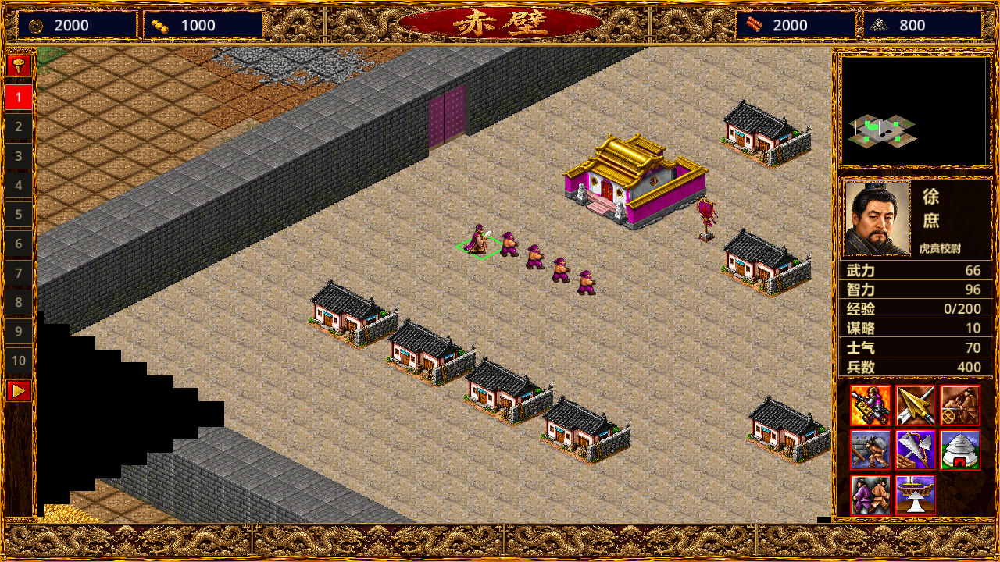
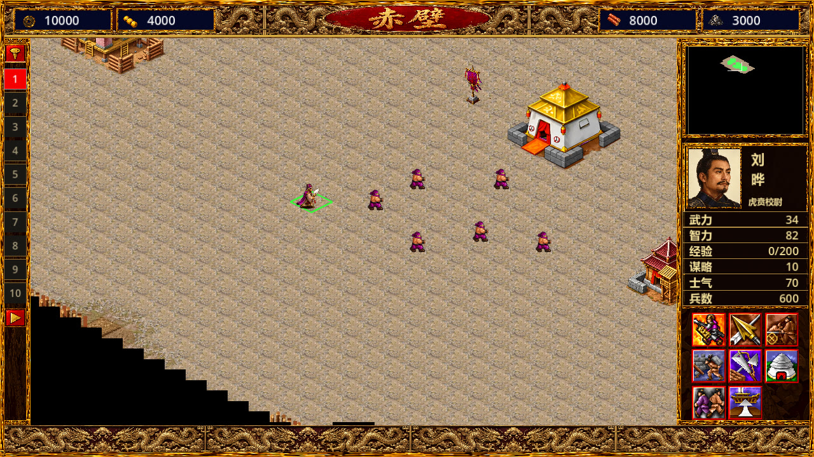

# 赤壁之战 · 高清重制



*刘备线第一关「二吕进犯」：新野城内开局。*

重回新野，带着武将和部队打下一场仗。《赤壁之战 · 高清重制》是 1997 年《三国赤壁》（北京前导软件）的非官方、非商业社区 MOD。在重绘的等距战场上，采集资源、建造营地、调动编队，用阵法和计谋打赢一场场战役。

**Windows 10/11 x64 · 单机即时战略（RTS） · 曹操／刘备双战役 · 34 张关卡地图**

[查看发布动态](https://github.com/bamboosjtu/chibi_remake/releases) · [从源码试玩](#从源码试玩) · [反馈问题](https://github.com/bamboosjtu/chibi_remake/issues)

> 目前没有公开的 Windows 下载包。想先上手，可以在 Windows 上从源码运行。若有公开下载包，将在 [GitHub Releases](https://github.com/bamboosjtu/chibi_remake/releases) 提供。

## 战场实机


*曹操线第十关「初识水战」：刘晔小队的开局战场。*


*Windows 实机主菜单。*

第一次玩，可以从曹操线「侦察新野」或刘备线「二吕进犯」开始。左键选中或框选，右键移动、攻击或采集；`1–9` 呼出编队，`Ctrl + 数字` 编组，`Esc` 打开暂停菜单。[完整操作](docs/50-command-ui/01-interface.md) · [战役关卡表](docs/10-world/03-campaign.md)

## 从源码试玩

在 Windows 上准备 Git LFS、Node.js 22 和 Godot 4.7.2 x64。克隆仓库，把 Godot 可执行文件放在仓库根目录，再在 PowerShell 运行：

```powershell
git lfs install
git clone https://github.com/bamboosjtu/chibi_remake.git
cd chibi_remake
git lfs pull

# 把 Godot_v4.7.2-stable_win64.exe 放在当前目录后继续
node tools/build_terrain.mjs --dev
.\Godot_v4.7.2-stable_win64.exe --headless --path godot/chibi_remake --import
.\Godot_v4.7.2-stable_win64.exe --path godot/chibi_remake
```

这条路径使用仓库自带的关卡数据和 Git LFS 运行素材，不需要从原版光盘重新提取数据。若要生成可独立运行的 Windows 本机包，请看[构建与发布手册](release.md)。

## 开发与测试

[开发规格](docs/README.md) · [技术架构](docs/80-runtime/01-architecture.md) · [测试与验收](docs/80-runtime/05-testing.md) · [CI 运行记录](https://github.com/bamboosjtu/chibi_remake/actions/workflows/ci.yml)

Godot 工程入口为 [`godot/chibi_remake/project.godot`](godot/chibi_remake/project.godot)。CI 检查架构契约、关卡启动、存档和确定性；Windows 导出包、画面和玩法仍需本地验收。研究记录与已知差异见 [research/todo](research/todo/README.md)。

## 致谢与权利

感谢 **元茂大人** 的高清过场重制。来源与剪辑时间码见[高清过场素材来源与剪辑记录](campaign-media-provenance.md)。高清过场不分发，玩家可按[权利与分发](docs/95-legal/01-legal.md) §7 用 B 站高清修复母片自行剪辑。

本项目并非官方产品，也未获原作权利人的授权或背书。原作及第三方素材的权利归各自权利人所有；使用者应自行合法持有原版《三国赤壁》。详见[许可](LICENSE)、[致谢与第三方声明](NOTICE.md)及[权利与分发说明](docs/95-legal/01-legal.md)。
