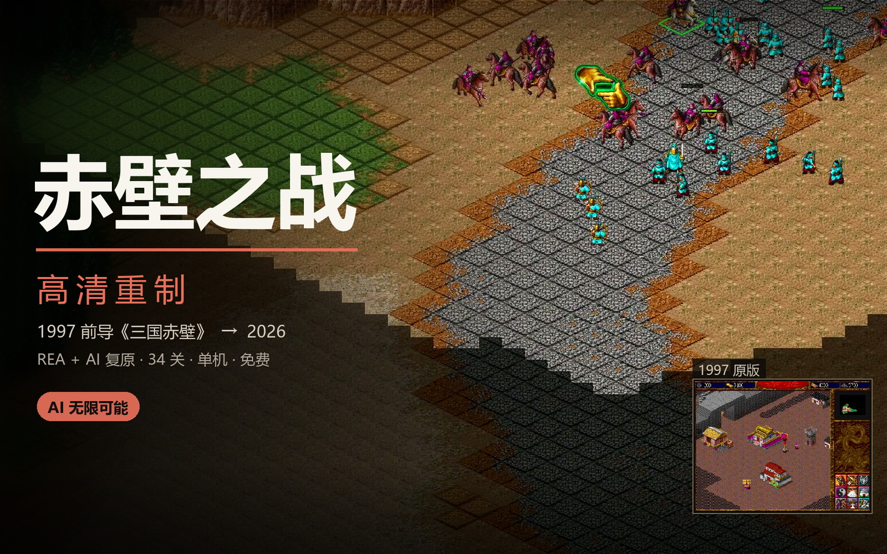

# 赤壁之战 · 高清重制

《三国赤壁》（1997，北京前导软件）的非官方社区重制：Godot 4.7.2、单机实时战略、曹操线与刘备线共 34 张等距战场。

> **非官方社区 MOD**：本项目不是官方产品，非商业使用。许可、致谢与分发边界见 [LICENSE](LICENSE)、[NOTICE](NOTICE.md) 与[权利与分发](docs/20-legal.md)。

## 下载

**v0.1.0 预发布（2026-10-31）**：[GitHub Releases 发布页面](https://github.com/bamboosjtu/chibi_remake/releases/tag/v0.1.0)

[](https://github.com/bamboosjtu/chibi_remake/releases/tag/v0.1.0)

当前为预发布版本；下载包、更新说明与问题反馈见发布页面。发布资产按 900 MiB 分卷，下载后运行 `join-release.ps1` 合并分卷并校验 SHA256，再启动 `ChibiRTS.exe`。

## 运行

```powershell
.\Godot_v4.7.2-stable_win64_console.exe --path godot/chibi_remake
```

双击 `release/ChibiRTS.exe` 启动已发布版本（启动器读取版本指针）。工程入口为 `godot/chibi_remake/project.godot`，默认窗口 1920×1080。

## 文档

开发规格集中在 [docs/](docs/README.md)：

| 文档 | 内容 |
|---|---|
| [概述](docs/01-overview.md) | 定位、范围、运行环境、术语 |
| [游戏流程](docs/02-game-flow.md) | 菜单、关卡进入、单局循环、胜负 |
| [资源与经济](docs/03-economy.md) | 采集、运输、交付与费用入口；其余玩法见 [docs/](docs/README.md) |
| [界面](docs/12-interface.md) | HUD、命令面板、光标与键鼠操作 |
| [技术架构](docs/14-architecture.md) | 分层、数据流、确定性与性能预算 |
| [数据规格](docs/15-data-spec.md) | JSON 字段与数值约定 |
| [存档](docs/16-save-compat.md) | 槽位、快照、校验与版本迁移 |
| [美术](docs/17-art.md) | 素材清单、命名、管线与验收 |
| [发布操作手册](release.md) | 从源码准备到打包、版本安装与回滚 |
| [构建发布](docs/18-build-release.md) | 依赖、产物契约、发布与回滚 |
| [测试](docs/19-testing.md) | 自检、模拟基线、回归与门禁 |

## 操作

- 左键点选/框选，`Shift` 加选；右键情境命令（攻击、采集、继续施工、移动）。
- 命令面板为 3×3 九格，`Q W E / A S D / Z X C` 对应；先点按钮、再点地图目标。
- 数字键 `1–9` 或左缘编号呼出编队：选中整队、主将排首位并把镜头定位到主将；`Ctrl + 数字` 编入；顶部「赤壁」、`M` 或 `Esc` 打开暂停菜单。
- 滚轮不缩放；边缘、中键拖动或方向键平移；`F` 视角归中。

完整说明见[界面](docs/12-interface.md)。

## 构建与本地试玩

需要 Node.js 22、PowerShell 5.1 或 7、Godot 4.7.2 引擎、同版本 Windows x86_64 导出模板，以及 .NET Framework 4 的 `csc.exe`（编译启动器）。模板可通过 `CHIBI_GODOT_TEMPLATES` 指定。

```powershell
# 试玩：构建并安装到 release/versions，切换当前指针（允许未提交改动）
powershell -NoProfile -ExecutionPolicy Bypass -File .\tools\release.ps1 -Mode preview

# 发布包：干净工作区构建，分卷到 dist/package（单资产 < 1 GiB）
powershell -NoProfile -ExecutionPolicy Bypass -File .\tools\release.ps1 -Mode release -Tag v0.1.1
```

`release.ps1` 的 `preview` 只安装到本机 `release/versions`，完成后双击 `release\ChibiRTS.exe` 试玩；`release` 额外调用 `package_release.ps1` 生成上传用分卷。底层仍由 `tools/build_release.ps1` 完成暂存、地形编译、导入、导出、**全地图载入、候选包冒烟与确定性基线**、构建清单和不可变发布；`-SkipBuild` 只重新打印或分卷当前版本。发布会拒绝无证据、覆盖不全或产物已变化的候选。机器验收覆盖载入、核心交互及确定性，画面与玩法验收仍由人工完成。绿色发行物默认显式使用本地 `userdata`；`-NoPublish` 生成并验证候选，`-NoOriginalMedia` 可排除原作音视频。逐步操作见 [release.md](release.md)。

仓库版本管理源码、关卡 JSON、规则、配置，以及运行和标准构建需要的最小素材集。当前运行图集、地形分块、UI、字体、图标、音视频和解码 DLL 使用 Git LFS；参考图、烘焙整图、额外生产母版和过程稿仅本地保存。新克隆先获取 LFS 素材，再安装引擎和导出模板：

```powershell
git lfs install
git clone <仓库地址>
cd <仓库目录>
git lfs pull
node tools/ci_lightweight.mjs
node tools/bootstrap.mjs --check -SkipData
node tools/audit_clone_inputs.mjs
powershell -NoProfile -ExecutionPolicy Bypass -File tools/build_release.ps1 -SkipData
```

Godot 引擎和导出模板仍需安装到上文指定位置。`-SkipData` 使用仓库中的关卡数据，不需要 REA、原始光盘解包或研究脚本。重新从发行文件导出地图才需要本地 `_work/iso`、`_work/dec`、`_work/hd`。研究结果 JSON 作为规则与测试输入保留；`research/**/tools`、研究目录中的可执行脚本和 REA 工作目录不提交。运行数据导入和构建工具属于开发工具链，继续保留。

`tools/inputs/runtime_assets.sha256` 是最小运行素材及必要导入配置的白名单。`node tools/runtime_assets.mjs --check` 核对打包输入和文件大小，追加 `--hash` 校验 SHA-256；新增运行素材后执行 `--write` 更新快照和忽略规则白名单。`node tools/audit_clone_inputs.mjs --index` 检查所有必需素材已跟踪、LFS 指针匹配快照且没有参考图或未声明素材；不带参数时检查本地运行输入。地形源输入位于 `source/terrain`（65 个声明输入，PNG 使用 LFS）。构建自动生成整图和分块到 `_work/terrain`；派生物不再跟踪 Git。开发工程执行 `node tools/build_terrain.mjs --dev` 准备资源。重新导出 MED 层数据才需要原始光盘输入。

首次从源码运行前，执行 `Godot_v4.7.2-stable_win64_console.exe --headless --path godot/chibi_remake --import` 导入运行素材和原生扩展。地形分块目录通过 `.gdignore` 跳过纹理导入，运行时直接解码；构建暂存不复制这个标记，编译后的分块仍正常进入发布包。

## 发布产物

```
release/
├── ChibiRTS.exe            启动器
├── current.json            版本指针
├── current.json.bak        上一版指针
├── launcher.previous.exe   上一版启动器
└── versions/<版本>/
    ├── ChibiRTS.exe        游戏成品
    ├── ChibiRTS.pck        必须同名同目录
    ├── release-info.json   版本、提交、构建时间与哈希
    └── build-manifest.json 构建清单（日志不随包）
```

`.pck` 必须与 `.exe` 同名同目录；导出预设保持 `binary_format/embed_pck=false`。本地试玩直接使用 `release/versions`；发布打包输出在 `dist/package/`（`.partNNN` 分卷、`join-release.ps1`、`SHA256SUMS.txt`），手动上传到 GitHub Release。

## 验证

```powershell
$env:APPDATA = (Resolve-Path "_work\godot_appdata").Path

# 断言式自检
.\Godot_v4.7.2-stable_win64_console.exe --headless --path godot/chibi_remake `
  res://main.tscn -- --map=CHIBIC1 --selftest

# 固定 tick 摘要
.\Godot_v4.7.2-stable_win64_console.exe --headless --path godot/chibi_remake `
  res://main.tscn -- --map=chibic1 --simtest=15
```

- 自检通过输出 `SELFTEST RESULT: PASS` 且退出码 0。
- 摘要与 `tools/inputs/baselines.json` 比较；修改模拟或通行数据后必须显式更新基线。
- GitHub Actions 运行两个工作流：`contracts` 执行 `tools/ci_lightweight.mjs`（注册表、分层、素材白名单、发布套件形状，不需要引擎或 LFS），`ci` 运行 `tools/syntax_check.mjs`、PowerShell 语法解析，以及不依赖 LFS 的 Godot 轻量门禁（`check_runtime_scripts` 编译运行脚本，`test_architecture --noview` 加载第一关并验证核心模拟）；完整回归、构建、分卷和发布都在本地执行，入口见[测试与验收](docs/19-testing.md)与[构建发布](docs/18-build-release.md)。

## 目录

| 目录 | 用途 |
|---|---|
| `godot/chibi_remake` | 源码、场景、工程设置、数据、媒体与高清素材 |
| `tools` | 导出、素材管线、构建、验证与发布 |
| `docs` | 开发规格与生成的数据附录 |
| `godot/chibi_remake/art/production` | 契约、提示词与交付记录随 Git；参考图仅本地保留；均不进入发布包 |
| `release` | 发布产物（不入 Git） |
| `_work` | 构建输入与本地过程产物（不入 Git） |
| `_tools`、`_rea` | 本地工具依赖 |

Git 跟踪源码、配置、关卡与规则 JSON、素材契约、哈希清单、提示词、交付记录和最小运行素材。参考图、整图烘焙源、额外母版、过程稿、自动报告、截图、缓存和发布结果不进入 Git。普通素材的导入配置及 UID 随文件维护；地形 JPEG 直接解码，其生成的 `.import` 保持忽略。

## 清理

```powershell
pwsh -NoProfile -File tools/cleanup_project.ps1            # 预览
pwsh -NoProfile -File tools/cleanup_project.ps1 -Execute   # 执行
```

清理范围、安全校验与必留清单见[构建与发布](docs/18-build-release.md#9-清理)。
